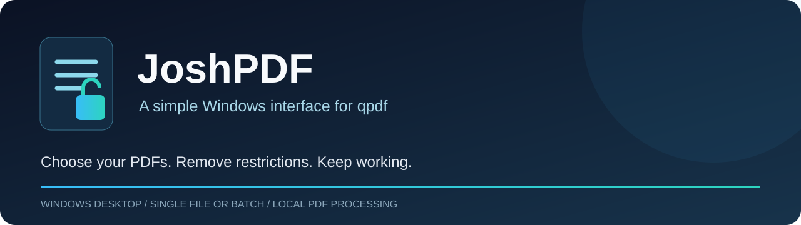
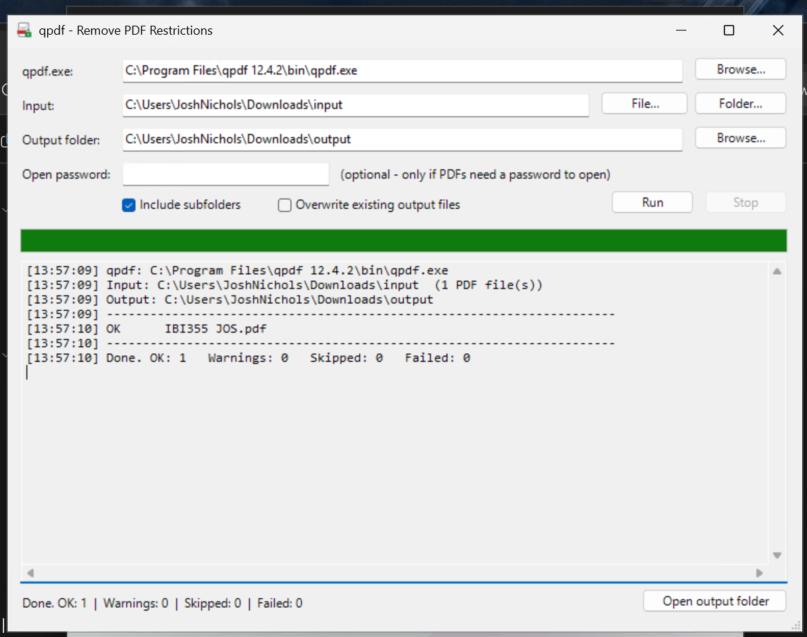

# JoshPDF

**Remove PDF copy, print, and editing restrictions from one file or an entire folder.**

A Windows desktop interface for [qpdf](https://github.com/qpdf/qpdf), built with PowerShell and Windows Forms. The application and installer appear as **qpdf GUI**.

**[Releases](https://github.com/jman9895/JoshPDF/releases)** · **[User guide](docs/USER-GUIDE.md)** · **[Installation](docs/INSTALLATION.md)** · **[Developer notes](docs/DEVELOPMENT.md)**

## Your PDFs, ready to use

Select a PDF or a folder, choose where the unlocked copies should go, and click **Run**. JoshPDF calls qpdf locally, preserves existing text layers, and shows a result for each file as it works. The supplied application code contains no document-upload service or telemetry.

*One window for input, output, progress, and results. A completed run shows totals for successful, warning, skipped, and failed files.*

## Made for individual files and batch work

| Feature | How it helps |
|---|---|
| **Single PDF or whole folder** | Choose one document or process PDFs throughout a folder tree. |
| **Preserved folder structure** | Subfolders are recreated beneath the output folder. |
| **Visible progress** | Live file results, a progress bar, and totals keep the run easy to follow. |
| **Skip existing copies** | Existing output files are skipped by default; enable overwrite when needed. |
| **Open-password support** | Supply a known password for documents that require one to open. |
| **Failure report** | Failed paths and errors are saved in a timestamped text file. |
| **Graceful stop** | Stop after the current PDF finishes. |
| **One-step Windows setup** | The installer adds shortcuts and attempts to install qpdf through winget. |

## Get started

**Installer publication is pending.** Source and guides are available now; the v1.1.1 binary will be attached to GitHub Releases.

1. Download **qpdf-gui-setup-1.1.1.exe** from the [release page](https://github.com/jman9895/JoshPDF/releases/tag/v1.1.1).
2. Run setup with administrator approval. Internet access and winget are needed for automatic qpdf installation.
3. Open **qpdf GUI** from Start. Choose **File…** or **Folder…**, check the output folder, and click **Run**.
4. Review the summary, then select **Open output folder**.

**Requirements:** Windows 10/11 x64, Windows PowerShell 5.1, and qpdf. Setup uses an elevated interactive user session; it is not a SYSTEM-context deployment package. The supplied installer is unsigned; check its source and SHA-256 checksum before deciding whether to run it. See [installation and recovery](docs/INSTALLATION.md).

Prefer running the source? Install qpdf with `winget install --id QPDF.QPDF -e`, then keep `qpdf-gui.ps1` and `qpdf-gui.cmd` together and launch the CMD file. Include the icon alongside them for the app icon.

## What to expect

| Supported | Outside this tool's scope |
|---|---|
| Remove PDF owner restrictions on copying, printing, and editing | Guess or recover an unknown password needed to open a PDF |
| Process password-protected PDFs when you provide the open password | OCR image-only scans into selectable text |
| Write output PDFs without printing or rasterizing their pages | Remove third-party DRM wrappers such as FileOpen or LiveCycle |
| Keep source files separate with the recommended output-folder workflow | Verify signatures or guarantee that every damaged PDF is repairable |

Use it on documents you are authorized to change. Unlocked copies no longer carry the original PDF permission restrictions; choose their destination accordingly. Use a separate output folder outside the input tree. The app adds `-decrypted` when input and output roots match, but repeated in-place runs can create extra copies and filename collisions. See [file-handling details](docs/USER-GUIDE.md#output-and-overwrite-behavior).

## Explore the documentation

| Guide | Contents |
|---|---|
| [User guide](docs/USER-GUIDE.md) | Every control, workflows, passwords, output handling, status codes, and troubleshooting |
| [Installation and IT reference](docs/INSTALLATION.md) | Setup, portable use, silent installation, dependency discovery, logs, and uninstall |
| [Developer notes](docs/DEVELOPMENT.md) | Source map, build procedure, implementation decisions, known limits, and validation checklist |
| [Changelog](CHANGELOG.md) | Published baseline and documentation history |
| [Release checksums](docs/CHECKSUMS.md) | SHA-256 verification for the supplied v1.1.1 installer |
| [Third-party notices](THIRD-PARTY-NOTICES.md) | qpdf and Inno Setup attribution and project licensing status |

## Source and builds

The application source, launcher, icon, dependency helper, and Inno Setup definition live at the repository root. Run `build.cmd` on Windows to compile an installer into `output/`. Compiled installers belong in **GitHub Releases**, rather than source control. The uploaded Word manual is not distributed here; its operating guidance is available in the Markdown guides.

This repository's own code does not yet have an explicit license grant. See [third-party notices](THIRD-PARTY-NOTICES.md) before redistribution. JoshPDF is an independent interface for qpdf and is not the upstream qpdf project.
