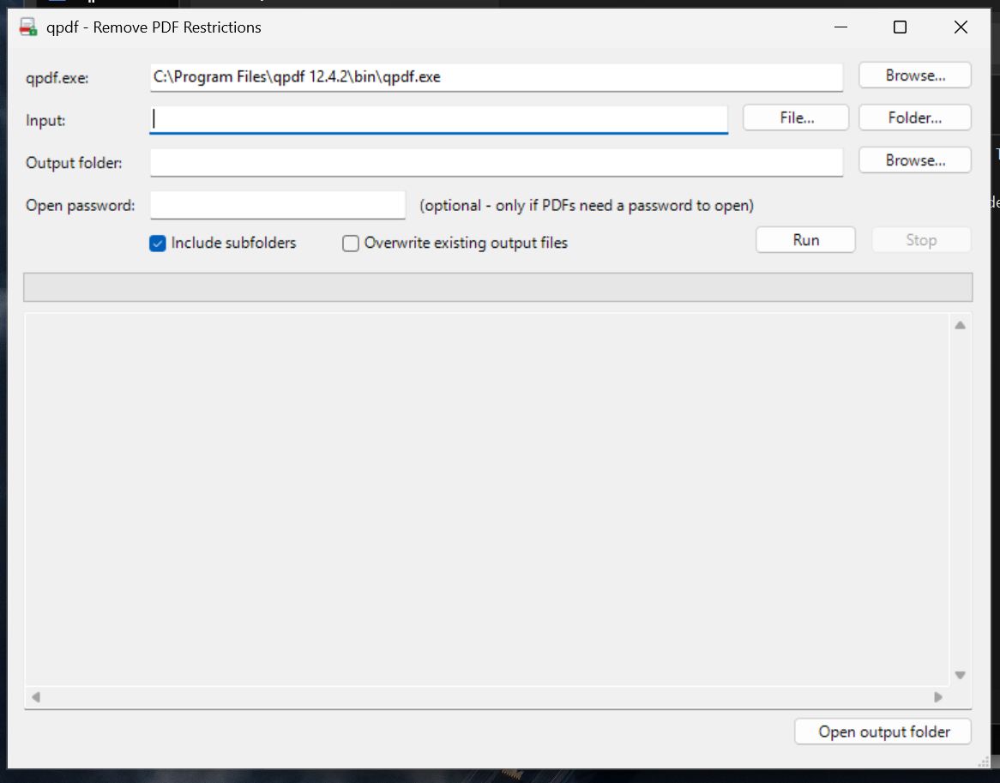
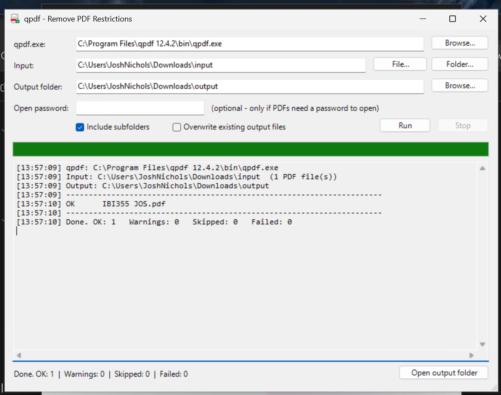

# Using JoshPDF

[← Back to README](../README.md) · [Installation](INSTALLATION.md) · [Developer notes](DEVELOPMENT.md)

JoshPDF appears on your desktop as **qpdf GUI**. It removes PDF permission restrictions using qpdf and saves output copies to the folder you choose. It preserves an existing text layer; it does not perform OCR or recover unknown open passwords.

## The window



| Control | Purpose and default |
|---|---|
| **qpdf.exe** | Automatically detected executable path. Use **Browse…** if detection is blank or you need another installation. |
| **Input → File…** | Select one PDF. If output is blank, suggests a `Decrypted` folder next to it. |
| **Input → Folder…** | Select a folder. If output is blank, suggests a sibling folder named `<input>_Decrypted`. |
| **Output folder** | Destination for output PDFs, created when the run begins. A previous output selection is retained when you change input. |
| **Open password** | Masked field for a known password required to open the input. Leave blank if no open password is needed. One password applies to the whole batch. |
| **Include subfolders** | Enabled by default; finds PDFs below the chosen folder and preserves their relative paths. |
| **Overwrite existing output files** | Disabled by default; existing destination files are skipped. |
| **Run** | Starts enumeration and processing. Disabled while a run is active. |
| **Stop** | Requests a stop after the current qpdf process completes. |
| **Progress and log** | File-by-file results and processed count. |
| **Open output folder** | Opens the current destination in File Explorer. |

## Unlock one PDF

1. Choose **File…** and select the document.
2. Review the output folder; a separate destination is recommended.
3. Enter the known open password if the PDF requires one.
4. Click **Run**, then review the result.
5. Open the output copy in a PDF reader and check its appearance, selectable text, and printing as appropriate.

## Process a folder

1. Choose **Folder…** and select the source.
2. Choose an output folder outside the source tree.
3. Keep **Include subfolders** enabled for recursive processing, or clear it for the top folder only.
4. Leave overwrite disabled for the initial run.
5. Click **Run** and review all warnings and failures at completion.

For PDFs with different open passwords, use separate batches. A stopped run finishes the current file and leaves completed output in place. The final text still says `Done`; the log includes `Stopped by user`, and the progress count may be below the total.

## Output and overwrite behavior

Relative paths are preserved for folder input. For example, `Input\Reports\April.pdf` becomes `Output\Reports\April.pdf`. A single-file run normally retains the input filename beneath the output folder.

Existing output files are skipped unless overwrite is enabled. This is based on filename existence, not a comparison of contents or modification time; changed source PDFs can still be skipped.

When the resolved input and output roots match, the app appends `-decrypted` to output basenames. Prefer separate roots: previously generated files can be included in a later run, and `report.pdf` can target an existing `report-decrypted.pdf`. With overwrite enabled, an existing destination can be replaced or deleted on qpdf failure. Do not rely on the suffix as a universal backup mechanism.

An output folder nested beneath input is not excluded from recursive enumeration. The file list is captured at run start, so newly created files do not continuously feed the same run, but existing output PDFs may be processed on later runs. Keep the output outside the input tree.

## Read the results



| Result | Meaning | Next step |
|---|---|---|
| `OK` | qpdf returned exit code 0. | Check the output document as needed. |
| `WARN` | qpdf returned exit code 3; output was produced with warnings. | Read the warning and inspect the copy. A warning does not always mean a repair occurred. |
| `SKIP` | Destination exists and overwrite is disabled. | Leave it or intentionally rerun with overwrite. |
| `FAIL` | qpdf returned another exit code, or processing threw an exception. | Read the error and review the failure report. |

A non-success qpdf exit triggers best-effort deletion of the destination. An exception follows a separate path and may leave a partial output file. Inspect failed destinations rather than assuming they are absent or valid.

If failures occur, `qpdf_failed_yyyyMMdd_HHmmss.txt` is written beneath the output root. It includes input context and full failed paths with errors separated by tabs. No new failure report is written for an all-successful run; older reports remain. The visible live log is cleared at the next run and is not automatically saved as a complete transcript.

## Check a result

Open the output copy, confirm its pages and text, and try the required copy or print operation. A scanned PDF may still have no selectable text. In a compatible PDF reader, inspect document security properties. If qpdf is available at the command line, you can also run:

```powershell
& 'C:\Program Files\qpdf <version>\bin\qpdf.exe' --show-encryption 'C:\PDF-Output\document.pdf'
```

Expect the output PDF to be unencrypted. The GUI itself does not execute this additional check. Rewriting signed PDFs may affect signature validity; retain the signed original and validate your workflow separately.

## Troubleshooting

| Symptom | What to check |
|---|---|
| No GUI after launch | The original operating notes report a slow first launch, sometimes 30–60 seconds. Wait once, then use the visible-console command below if needed. |
| Blank qpdf path | Install qpdf, restart the GUI, or browse to `qpdf.exe`. |
| Invalid password | Supply the correct open password. Split batches that use different passwords. |
| Not a PDF / missing PDF header | Re-download or re-export the source; changing an extension does not make it a PDF. |
| Access denied | Check destination permissions, free space, and whether another program has the file open. |
| Text still cannot be selected | The source may be an image-only scan and need OCR. |
| Unexpected `SKIP` | A same-name destination exists; it is not a contents-based comparison. |
| Stop appears to wait | Stop does not kill the running qpdf process; it is checked between files. |
| Controls remain disabled after an error | Record the error, inspect output, and restart. Some directory/report operations are outside the per-file error handler. |

To expose launch errors, open a console and run:

```powershell
powershell.exe -NoProfile -ExecutionPolicy Bypass -STA -File 'C:\Program Files\qpdf GUI\qpdf-gui.ps1'
```

## Passwords and local data

The application masks the password field and does not intentionally add it to its log. The password is passed to qpdf as a process argument and may be visible to tools with process-inspection access. PDF content is processed locally by the supplied scripts; setup separately accesses winget sources to install dependencies. Failure reports contain document paths and error details. Review them before sharing.
